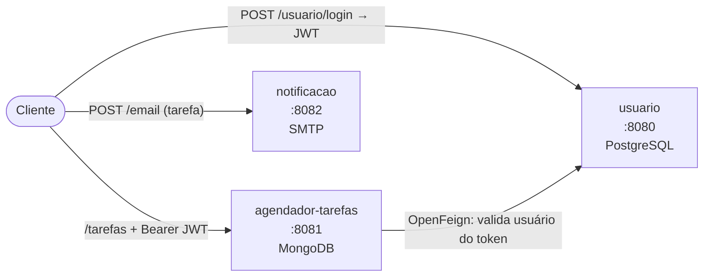

# 👤 Usuario — Microsserviço de usuários e autenticação

Microsserviço responsável pelo **cadastro de usuários** (com endereços e telefones) e pela **autenticação com JWT**. É a porta de entrada do sistema de agendamento de tarefas.


## ✨ Funcionalidades

- Cadastro, busca, atualização e exclusão de usuários
- Cadastro e atualização de endereços e telefones vinculados ao usuário
- Login com e-mail e senha que gera um **token JWT**
- Rotas protegidas por **Spring Security** com filtro JWT
- Senhas armazenadas com hash (BCrypt)
- Pipeline de **CI no GitHub Actions** (build e testes a cada push)

## 🧱 Stack

Java 17 · Spring Boot 4 (Web MVC, Data JPA, Security) · PostgreSQL · JJWT · Lombok · Gradle · GitHub Actions

## 🏗️ Estrutura

```
src/main/java/com/Amorim/usuario/
├── controller/        # endpoints REST
├── business/          # regras de negócio, DTOs e conversores
└── infrastructure/
    ├── entity/        # Usuario, Endereco, Telefone (JPA)
    ├── repository/    # Spring Data JPA
    ├── security/      # JWT (geração/validação) e configuração do Spring Security
    └── exceptions/    # ConflictException, ResourceNotFoundException
```

## 🧩 Arquitetura do sistema

Este repositório faz parte de um **sistema de agendamento de tarefas com notificação por e-mail**, dividido em 3 microsserviços Spring Boot:

| Serviço | Porta | Banco | Responsabilidade |
|---|---|---|---|
| [usuario](https://github.com/EduardoAmorimGit/usuario) | 8080 | PostgreSQL | Cadastro de usuários, endereços e telefones; login e emissão de JWT |
| [agendador-tarefas](https://github.com/EduardoAmorimGit/agendador-tarefas) | 8081 | MongoDB | CRUD de tarefas do usuário e controle do status de notificação |
| [notificacao](https://github.com/EduardoAmorimGit/notificacao) | 8082 | — | Envio de e-mail HTML (Thymeleaf + SMTP) avisando sobre a tarefa |



1. O usuário se cadastra e faz login no serviço **usuario**, que devolve um token JWT.
2. Com o token, ele cria e gerencia tarefas no **agendador-tarefas**. O agendador lê o e-mail do token e confirma o usuário no serviço **usuario** via **OpenFeign**.
3. O serviço **notificacao** recebe os dados de uma tarefa e envia um e-mail de lembrete. Status das tarefas: `PENDENTE`, `NOTIFICADO`, `CANCELADO`.

## 🚀 Como rodar

Pré-requisitos: Java 17 e PostgreSQL com um banco chamado `db_usuario`.

```bash
# Ajuste usuário/senha do banco em src/main/resources/application.properties
./gradlew bootRun
```

A API sobe em `http://localhost:8080`.

## 📡 Endpoints

| Método | Rota | Auth | Descrição |
|---|---|---|---|
| POST | `/usuario` | — | Cadastra usuário |
| POST | `/usuario/login` | — | Faz login e retorna `Bearer <token>` |
| GET | `/usuario?email=` | JWT | Busca usuário por e-mail |
| PUT | `/usuario` | JWT | Atualiza dados do usuário logado |
| DELETE | `/usuario/{email}` | JWT | Remove usuário |
| POST | `/usuario/endereco` | JWT | Adiciona endereço ao usuário logado |
| PUT | `/usuario/endereco?id=` | JWT | Atualiza endereço |
| POST | `/usuario/telefone` | JWT | Adiciona telefone ao usuário logado |
| PUT | `/usuario/telefone?id=` | JWT | Atualiza telefone |

**Exemplo — cadastro e login**

```bash
curl -X POST http://localhost:8080/usuario -H "Content-Type: application/json" \
  -d '{"nome":"Maria","email":"maria@email.com","senha":"123456",
       "enderecos":[{"rua":"Rua A","numero":10,"cidade":"Rio de Janeiro","estado":"RJ","cep":"20000-000"}],
       "telefones":[{"ddd":"21","numero":"999999999"}]}'

curl -X POST http://localhost:8080/usuario/login -H "Content-Type: application/json" \
  -d '{"email":"maria@email.com","senha":"123456"}'
# → Bearer eyJhbGciOiJIUzI1NiJ9...
```

## 🗺️ Próximos passos

- [ ] Ler as credenciais do banco por variáveis de ambiente
- [ ] Testes unitários e de integração
- [ ] Docker Compose para subir os 3 serviços juntos
- [ ] Documentação com Swagger/OpenAPI

---

Desenvolvido por **Eduardo Amorim** · [LinkedIn](https://www.linkedin.com/in/eduardosiamorim)
